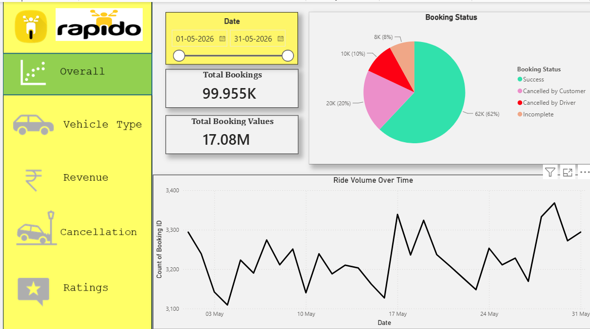

# 🛵 Rapido Ride Booking Analysis Dashboard

### Power BI | Excel | Data Analytics | Business Intelligence

An interactive data analytics project designed to analyze ride-booking performance, revenue trends, vehicle utilization, cancellation patterns, and customer satisfaction through a multi-page Power BI dashboard.

---

## 📌 Project Overview

The **Rapido Ride Booking Analysis Dashboard** provides a consolidated view of ride-booking operations and key business performance indicators.

The dashboard enables users to explore booking trends, compare vehicle categories, evaluate payment methods, investigate cancellation reasons, and monitor customer and driver ratings over a selected date range.

The objective is to transform raw booking data into meaningful insights that support data-driven decision-making and operational improvement.

## 🎯 Project Objectives

- Analyze overall ride-booking performance and booking status.
- Compare booking value and distance metrics across vehicle categories.
- Evaluate revenue distribution by payment method.
- Identify customer and driver cancellation patterns.
- Assess customer satisfaction and driver performance through ratings.
- Present business metrics using interactive visualizations.

## 🛠️ Tools & Technologies

| Tool | Purpose |
|---|---|
| Microsoft Power BI | Interactive dashboards and data visualization |
| Microsoft Excel | Dataset storage and data preparation |
| Data Analytics | KPI monitoring and business performance analysis |

## 📊 Dashboard Modules

### 1. Overall Analysis
- Total bookings and total booking value
- Booking status distribution
- Successful, cancelled, and incomplete bookings
- Daily booking volume trends

### 2. Vehicle Type Analysis
- Total booking value by vehicle category
- Successful booking value comparison
- Average distance travelled
- Total distance travelled by vehicle type

### 3. Revenue Analysis
- Revenue distribution by payment method
- Top customers by booking value
- Daily ride-distance trends
- Comparison of payment method performance

### 4. Cancellation Analysis
- Overview of total and successful bookings
- Customer cancellation reasons
- Driver cancellation reasons
- Identification of cancellation patterns

### 5. Ratings Analysis
- Driver ratings by vehicle type
- Customer ratings by vehicle type
- Comparative analysis of ratings across vehicle categories

## 📈 Key Performance Indicators (KPIs)

- **Total Bookings:** Overall booking volume
- **Total Booking Value:** Aggregate value of bookings
- **Successful Bookings:** Number of completed successful bookings
- **Cancelled Bookings:** Number of cancelled bookings
- **Average Distance Travelled:** Average ride distance
- **Customer Ratings:** Customer feedback across vehicle categories
- **Driver Ratings:** Driver performance ratings across vehicle categories

## 🖼️ Dashboard Preview

*The dashboard provides an interactive view of booking performance and operational metrics.*

## 💡 Business Insights & Applications

This dashboard can help stakeholders:

- Understand booking performance over time.
- Compare the contribution of different vehicle categories.
- Evaluate payment method distribution.
- Investigate customer and driver cancellation reasons.
- Monitor ratings to understand service quality.
- Identify areas that may require operational improvement.

*Actual findings should be documented after validating the underlying dataset and dashboard calculations.*

## 📁 Project Files

| File | Description |
|---|---|
| `rapido ride data analysis dashboard.pbix` | Power BI dashboard file |
| `rapido file.xlsx` | Excel dataset |
| `overall.png` | Dashboard preview image |

## 🚀 How to Explore the Project

1. Clone or download this repository.
2. Open the `.pbix` file using Microsoft Power BI Desktop.
3. Ensure the Excel data source is available and reconnect it if required.
4. Refresh the dataset if necessary.
5. Explore the dashboard pages and available filters.

## 🔍 Skills Demonstrated

- Data analysis and visualization
- KPI development and monitoring
- Interactive dashboard design
- Comparative and trend analysis
- Business performance reporting
- Excel and Power BI integration

## 📝 Conclusion

The Rapido Ride Booking Analysis Dashboard demonstrates the application of business intelligence techniques to ride-booking data. By combining key performance indicators with interactive visualizations, the project provides a structured approach to understanding booking operations, revenue distribution, cancellations, and service ratings.

## 👨‍💻 Author

**Gaurav Baghel**

Aspiring Data Analyst

**Core Skills:** Power BI | Excel | SQL | Python | Data Visualization

---

*Note: Dashboard figures and insights depend on the underlying dataset. Verify all metrics before using them in professional presentations or reports.*

